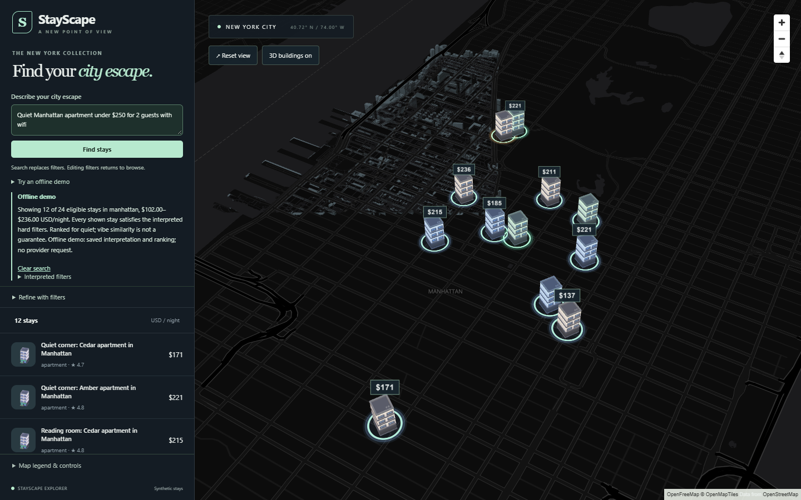

<!-- HF reads this metadata; GitHub displays the same portfolio README. -->

# StayScape

Explore synthetic New York stays in a 3D city, using filters or plain-language search.

**[Full walkthrough with screenshots](docs/WALKTHROUGH.md)** ? [60-second demo script](docs/demo-script.md) ? [Architecture talking points](docs/interview-talking-points.md)

Runs locally with no provider key. **No hosted deployment is planned**; the walkthrough demonstrates the working application. Optional deployment files are retained in [DEPLOY.md](DEPLOY.md) for future use.

<!-- Optional live-demo placeholder: add a URL only if you choose to host it later. -->

## Screenshots



See the [complete seven-screenshot tour](docs/WALKTHROUGH.md) for overview, details, filters, empty results and phone layouts.

<!-- Portfolio screenshot placeholder: replace with your preferred wide hero crop, keeping attribution. -->
<!-- Portfolio recording placeholder: add a 60-second recording using docs/demo-script.md. -->

## Features

- 300 reproducible stays across Manhattan, Brooklyn, Queens, Jersey City and Hoboken.
- Shared map/list/details results, debounced budget/capacity/type filters, retry and empty states.
- Four instanced house types, stable color variants, hover lift, price-tag declutter and camera easing.
- Framer Motion panels, reduced-motion support, collapsible phone explorer and visible map credits.
- Optional AI interpretation, strict filters, local semantic ranking and seven provider-free examples.

## Architecture and tech stack

```text
React + TypeScript + Vite
  Filters / search -> typed API client -> FastAPI + Pydantic
                                            |
                          optional compatible provider -> validated intent
                                            |
                                   SQLAlchemy -> SQLite
                                            |
                              eligible rows -> FastEmbed ranking
                                            |
                           deterministic explanation + camera bounds
                                            |
  useExplorer atomic snapshot <-------------+
       |              |             |
   sidebar         details       MapLibre camera + deck.gl instances
                                     |
                          OpenFreeMap tiles / local Kenney GLBs
```

React owns one completed-result snapshot; stale requests are aborted. Map, list and selection read that snapshot. Manual filtering closes a removed selection without resetting the camera; a new search fits the returned bounds. Vite proxies `/api` and `/static` in development to avoid cross-origin setup and keep keys in the backend. Production sets `VITE_API_URL` to the backend origin; it covers both API calls and placeholder images.

Other tools: Framer Motion, HTTPX, NumPy/ONNX through FastEmbed, pytest and Playwright. Versions are locked in `frontend/package-lock.json` and `backend/uv.lock`.

## How search works

1. A query becomes a Pydantic-validated intent. An optional single OpenAI-compatible provider extracts JSON, with one repair retry inside a total six-second deadline.
2. Missing credentials, invalid output or timeout uses a limited keyword parser (prices, guests, bedrooms, regions, amenities and known vibes). The response discloses that limitation. Complex language and negation are not reliably interpreted.
3. SQL enforces hard constraints before ranking. Local `BAAI/bge-small-en-v1.5` FastEmbed vectors rank eligible stays by vibe similarity; the top 12 are returned. Listing vectors are precomputed offline. FastEmbed worked here, so TF-IDF was not needed.
4. Explanation and camera bounds come from actual returned rows, not generated prose. No matches never silently relaxes constraints.
5. A bounded 128-entry, five-minute cache and a 20-searches/minute/IP limiter reduce repeat work. Both are process-local.

Suggestion chips use seven full saved responses in `backend/config/search-examples.json`, checked against current SQL data. They need no provider or embedding inference. Typed searches in default mode use rules plus local embeddings. The map still needs internet tile access: provider-free does not mean an entirely offline website.

### Optional free-provider setup

Use one provider's free-tier account, for example [Groq's compatible endpoint](https://console.groq.com/docs/openai). In `backend/.env`, set `SEARCH_DEMO_MODE=false`, `SEARCH_BASE_URL=https://api.groq.com/openai/v1`, your `SEARCH_API_KEY`, and a currently available `SEARCH_MODEL` from that account. Restart the backend. Keep the URL before `/chat/completions`. Check your provider's quota/billing settings; the app does not guarantee third-party free access. No live key was supplied for validation; provider repair/fallback was tested with a mock transport.

## Windows PowerShell setup

Prerequisites: Node 22.12+ (or compatible Node 20.19+), uv, and a WebGL2-capable browser. uv uses the pinned Python 3.12. Replace this checkout path if needed.

Fresh checkout only (do not regenerate an existing dataset unnecessarily):

```powershell
Set-Location 'C:\Users\dell\OneDrive\Desktop\3D-map\backend'
$env:UV_PROJECT_ENVIRONMENT = '.venv-m2'
uv sync --frozen --extra dev --cache-dir .uv-cache
if (!(Test-Path .env)) { Copy-Item .env.example .env }
.\.venv-m2\Scripts\python.exe -m app.cli generate --count 300 --seed 42
.\.venv-m2\Scripts\python.exe -m app.cli validate
.\.venv-m2\Scripts\python.exe -m app.cli seed
.\.venv-m2\Scripts\python.exe -m app.prepare_search
Set-Location ..\frontend
npm.cmd ci
```

Preparation downloads the embedding model once (approximately 67 MB). Re-run `app.prepare_search` after changing/reseeding listing text. Model cache and generated database/index are ignored by Git.

Terminal 1:

```powershell
Set-Location 'C:\Users\dell\OneDrive\Desktop\3D-map\backend'
.\.venv-m2\Scripts\python.exe -m uvicorn app.main:create_app --factory --host 127.0.0.1 --port 8000
```

Terminal 2:

```powershell
Set-Location 'C:\Users\dell\OneDrive\Desktop\3D-map\frontend'
npm.cmd run dev
```

Open http://127.0.0.1:5173. API docs: http://127.0.0.1:8000/docs. Ctrl+C stops each server.

## Environment variables

Copy `backend/.env.example` only if `.env` does not exist. No environment changes are required for this polish.

| Variable | Default / purpose |
| --- | --- |
| `APP_NAME`, `CURRENCY_CODE` | StayScape, USD |
| `DATABASE_URL` | Absolute local SQLite path when omitted; async Postgres supported |
| `ALLOWED_ORIGINS` | JSON array of exact permitted frontend origins; legacy `CORS_ORIGINS` still works |
| `REGIONS_FILE`, `PRICING_FILE` | Optional absolute configuration paths |
| `SEARCH_DEMO_MODE` | `true`: disable provider interpretation |
| `SEARCH_BASE_URL`, `SEARCH_API_KEY`, `SEARCH_MODEL` | One backend-only compatible endpoint and credentials |
| `SEARCH_TIMEOUT_SECONDS` | 6 seconds total including one repair |
| `SEARCH_RATE_PER_MINUTE` | 20 per direct client IP |
| `VITE_API_URL` | Blank locally (Vite proxy); deployed HTTPS backend origin, without `/api` |
| `VITE_CURRENCY_CODE` | USD presentation setting; never place secrets in `VITE_` variables |

## Data and attributions

All stay records, descriptions, prices and coordinates are synthetic. No rental listings were scraped. Generated coordinates use configured region polygons, not real rental addresses. Placeholder SVGs are project-authored illustrations, not property photography. Models are illustrative Kenney City Kit assets (CC0); the local preview PNGs are from those packs. OpenFreeMap supplies tiles/styles from OpenStreetMap and OpenMapTiles. Preserve the visible credit strip in screenshots and video. Full sources, modifications and licenses: [CREDITS](CREDITS.md).

## Design decisions and tradeoffs

- One result store prevents sidebar/map disagreement; old results remain visible while loading with an explicit notice.
- SQL owns eligibility; semantic similarity cannot override budget or required amenities.
- A deterministic explanation avoids unsupported claims, at the cost of less conversational language.
- Four shared model scenes and per-instance tints keep asset/GPU cost low. Separate map/listing depth makes symbols readable but not physically occluded by real roofs.
- Tag suppression favors selected/hovered stays. Both priority tags can overlap in a very dense view.
- SQLite and process-local cache/limiter are simple for a read-only demo, not a horizontally scaled service.
- Mobile controls occupy a collapsible lower panel; this trades simultaneous list visibility for map space. Reduced motion removes animated travel.
- The map stack produces a large initial bundle (current main chunk about 675 KB gzip). M3's historical warm hardware benchmark was 47.4 FPS on Intel Iris Xe at 1280x800; it is not a new M5 measurement or a phone guarantee.

## Checks and portfolio material

```powershell
Set-Location 'C:\Users\dell\OneDrive\Desktop\3D-map\frontend'
npm.cmd run build
# Backend must be running for the real-map test. Edge is the default test browser.
npm.cmd run test:browser -- tests/client.spec.ts tests/explorer.spec.ts tests/polish.spec.ts
Set-Location ..\backend
.\.venv-m2\Scripts\python.exe -m pytest
```

- [60-second demo script](docs/demo-script.md)
- [Eight interview talking points](docs/interview-talking-points.md)
- [Deployment assessment and exact proposed steps](docs/deployment-assessment.md) — nothing deployed
- [M5/M6 file changes and browser checklist](docs/m5-m6-handoff.md)

## Cold starts and hosting limits

The backend may sleep. After four seconds the first connection shows a waking/unreachable message and Retry; it allows up to 90 seconds before timing out. Later requests retain the 15-second timeout. Suggestions also allow 90 seconds. SQLite is bundled read-only; temporary files go to `/tmp`, so restarting loses no user data (there are no user writes).

Verify current [Hugging Face plan eligibility, CPU/RAM/disk and sleep rules](https://huggingface.co/docs/hub/spaces-overview) before creating a Space: Docker Space creation currently requires a paid plan even though CPU Basic has no hourly compute charge. Check [Vercel Hobby](https://vercel.com/docs/plans/hobby) personal/non-commercial restrictions, transfer/CDN request allowances, build/deployment limits and over-limit behavior. The frontend is static; no Vercel Functions are needed. Verify any optional AI provider quota separately.

## What I'd do next

Measure real phone GPUs, split the heavy map bundle, evaluate search relevance against a small labeled query set, then test memory and cold starts on the chosen host. A real product would also need licensed live inventory, accessible non-map browsing, a persistent database, shared rate limiting and operational monitoring. These are future ideas, not implemented features.

