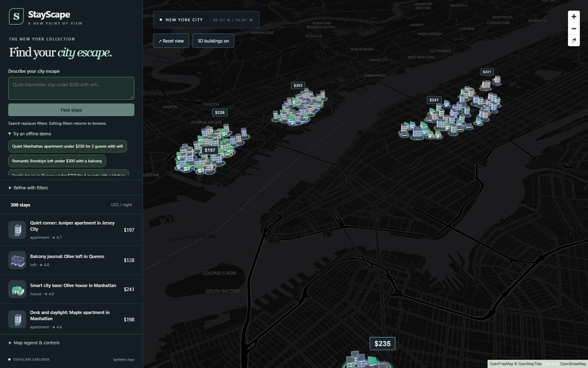
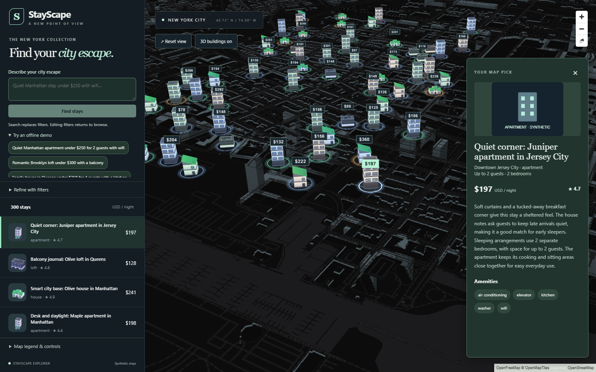
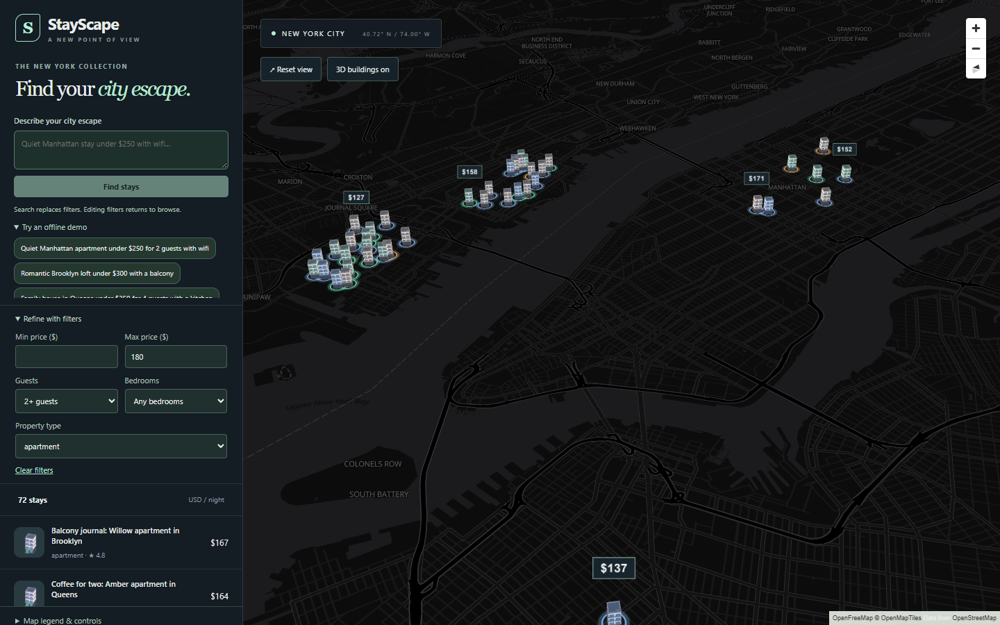
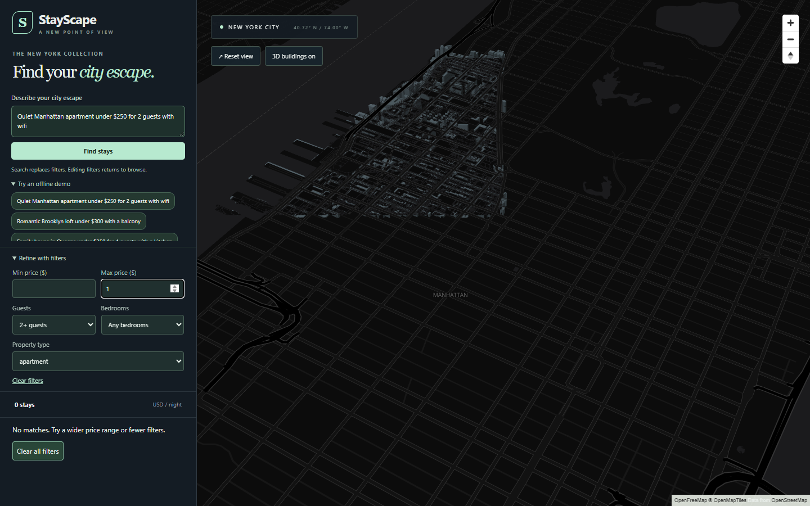
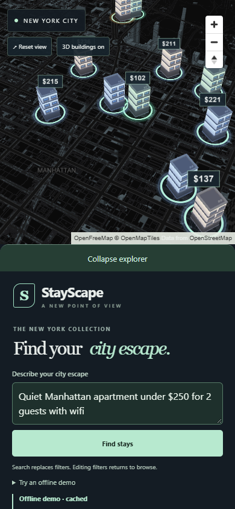
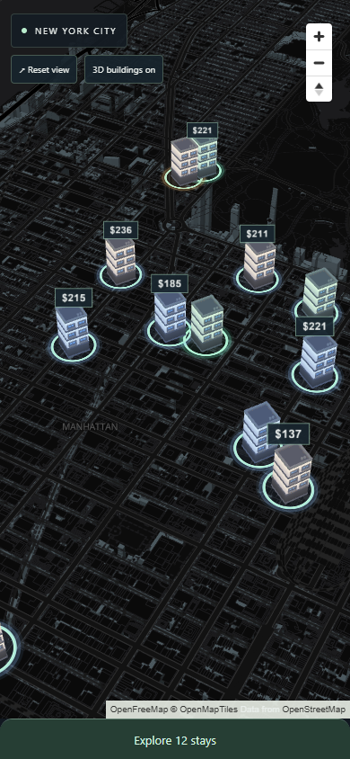

# StayScape: complete local walkthrough

StayScape is a portfolio demo for exploring **300 synthetic New York-area stays** on a 3D map. All screenshots below are from the working local application. No hosting subscription, provider key or paid deployment is required to follow this walkthrough.

This is an explorer, not a booking service: prices, descriptions and locations are synthetic. The city map needs internet access for OpenFreeMap tiles. Seven saved search examples work without an AI provider; typed searches use the disclosed keyword parser and local FastEmbed ranking by default.

## 1. Run it locally

The existing workspace has its database, model cache and dependencies ready. For a fresh clone, follow the [README setup](../README.md#windows-powershell-setup) first; it installs locked dependencies, seeds 300 stays and prepares the local embedding index.

Open two Windows PowerShell terminals:

```powershell
Set-Location 'C:\Users\dell\OneDrive\Desktop\3D-map\backend'
.\.venv-m2\Scripts\python.exe -m uvicorn app.main:create_app --factory --host 127.0.0.1 --port 8000
```

```powershell
Set-Location 'C:\Users\dell\OneDrive\Desktop\3D-map\frontend'
npm.cmd run dev
```

Visit **http://127.0.0.1:5173**. API docs are at **http://127.0.0.1:8000/docs**. Keep `SEARCH_DEMO_MODE=true`; no API key is needed. Keep `VITE_API_URL` blank for local development so Vite forwards API/image requests to port 8000. Stop each terminal with Ctrl+C.

## 2. Explore the city

The sidebar starts with 300 stays across Manhattan, Brooklyn, Queens, Jersey City and Hoboken. Drag to pan, scroll to zoom, and right-drag to tilt. The Reset view button returns to the overview.

Models indicate apartment, townhouse, house or loft. Rings indicate rating; price tags are USD per night. Tags thin out at wider zoom levels to reduce overlap. The legend expands in the sidebar, keeping map content clear. Attribution stays visible at the edge of the map.



## 3. Inspect a stay

Hover a model to see its preview and lift effect. Click a model or sidebar row to select it: the camera moves to the same stay and the details panel opens. Inspect its title, neighborhood, nightly price, rating, capacity, description and amenities.

The image is explicitly a placeholder illustration, not photography of a real property. Close the details panel with its close button. Selecting a different stay replaces the details; merely refreshing/filtering data does not trigger another flight.



## 4. Filter the collection

Expand **Refine with filters**. For the illustrated example, set **Max price = 180**, **Guests = 2**, and **Property type = apartment**. You can also set a minimum price and bedroom count. Changes are debounced before the backend request.

The map and list derive from one completed-result snapshot. Models animate when the set changes. If a filter removes the selected stay, details close and the camera keeps its position. Clear filters restores the full collection. The screenshot resets the view after filtering to show the geographic spread.



## 5. Try provider-free AI search

Clear the filters and click the first suggestion under **Try an offline demo**:

> Quiet Manhattan apartment under $250 for 2 guests with wifi

The saved example returns 12 ranked stays from its eligible set, explains the actual returned results and fits the camera around them. The response is labeled **Offline demo**, so it is clear this was not a live provider request. Repeating a query may show a cache indicator.


For a live local search, type a different query, such as **Family house in Queens under $350 for 4 guests with a kitchen**, then click **Find stays**. Without a configured provider, the UI says **Keyword fallback** and discloses its limited interpretation. Review the interpreted filters; complex phrasing, dates and arbitrary requirements are not supported reliably.

The search pipeline is deliberately constrained:

```text
Query
  -> optional provider interpretation OR limited keyword parser
  -> strict validated filters
  -> SQL hard constraints (budget, guests, property, region, amenities)
  -> local FastEmbed similarity ranking among eligible stays
  -> actual-result explanation + bounds
  -> one shared snapshot for sidebar, map and details
```

The optional provider only interprets filters; it does not invent the listing explanation. Editing manual filters returns to browsing. Saved examples need no provider or embedding inference, while typed queries use the locally prepared model.

## 6. Check empty results and recovery

After a search, open filters and set **Max price = 1**. The map clears and the sidebar explicitly says **No matches**, with a **Clear all filters** button. Requirements are never silently relaxed to manufacture matches.



If the backend is slow on the first connection, the UI shows **Backend is waking up or unreachable** after four seconds and offers Retry. Startup gets up to 90 seconds; later requests keep the usual shorter timeout. Other failed requests retain the last completed results with an error/retry notice. Retry suggestions and Retry image handle those resources independently.

## 7. Use the phone layout

Set the browser's responsive viewport to **390 × 844**, or use a phone-width window. Search, filters and listings sit in a scrollable lower panel. Details stay in that lower area so they do not cover the map's attribution.



Tap **Collapse explorer** to give the map more room; tap **Explore … stays** to reopen it. Controls do not erase the current search or selection when collapsed.



Turn on reduced motion in your OS or browser accessibility emulation: panel/result transitions and camera travel become immediate. The same interactions remain available.

## 8. Understand what this demonstrates

- Typed API boundaries and Pydantic validation separate browser presentation from backend records.
- One result snapshot prevents map/list disagreement and canceled requests prevent stale responses from winning.
- SQL enforces eligibility before similarity ranking, and explanations use actual returned data.
- Four shared model scenes support hundreds of instances; stable tints add variety without more model downloads.
- The dataset and saved examples are reproducible. Provider failure is disclosed rather than hidden.
- SQLite, local caches and one worker keep the demo simple; they are documented tradeoffs, not a production scaling claim.

See [eight interview talking points](interview-talking-points.md), the [60-second click-and-say script](demo-script.md), and [credits/licenses](../CREDITS.md). The optional Docker setup and memory evidence remain in [DEPLOY.md](../DEPLOY.md), but deployment was intentionally not performed.

## Recreate the screenshots

With the backend running, from `frontend`:

```powershell
npm.cmd run build
$env:BENCHMARK_HARDWARE = '1'
$env:BENCHMARK_HARDWARE = '1'
npm.cmd run test:browser -- tests/walkthrough.spec.ts
Remove-Item Env:BENCHMARK_HARDWARE
Remove-Item Env:BENCHMARK_HARDWARE
```

The browser test uses installed Edge and writes the seven screenshots to `docs/screenshots/`. It exercises the actual local backend and real map tiles. The screenshot run uses the local GPU and reduced motion for settled frames; interaction tests cover normal animations. The screenshot run uses the local GPU and reduced motion for settled frames; interaction tests cover normal animations. Keep attribution visible when cropping or recording. A recording can follow the 60-second script; these images are screenshots, not a claimed video capture.
