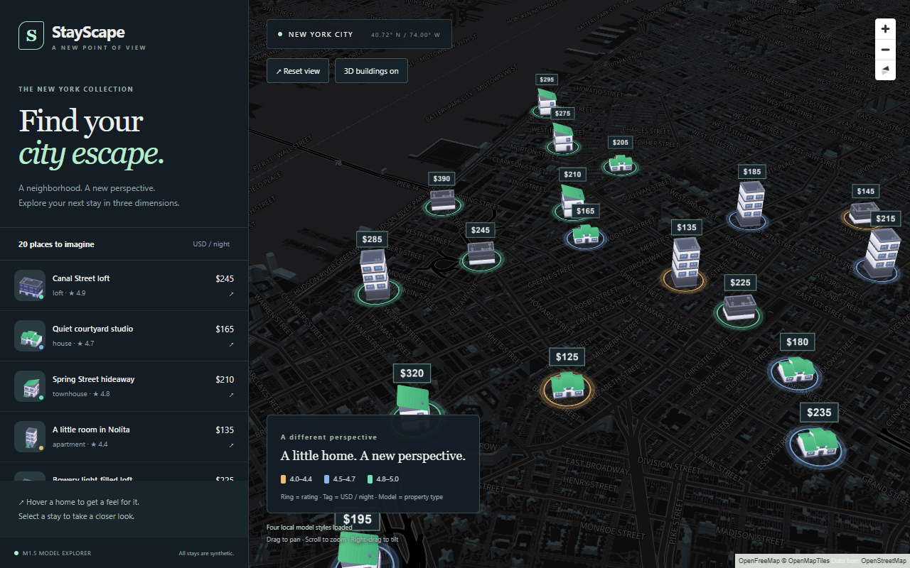

# M1.5: local model visual upgrade

M2 has not started. The normal view still contains 20 hand-authored fixtures.
`?benchmark=300` adds a deterministic render-only grid with 300 instances; those
points have no geographic validation and must not become the M2 dataset.

## Run and verify

From the repository root, in PowerShell:

```powershell
cd frontend
npm.cmd ci
npm.cmd run dev
```

Open http://127.0.0.1:5173. Models and thumbnails are already checked in; no model
download, asset conversion, API key, Python process, or AI provider is required.
The basemap still requires internet access. USD cents remain the fixture currency.

Production build and browser checks:

```powershell
npm.cmd run build
$env:BENCHMARK_HARDWARE = '1'
npm.cmd run test:browser
npm.cmd run preview
```

Tests use installed Microsoft Edge. Set `PLAYWRIGHT_CHANNEL=chrome` for installed
Chrome instead. Without `BENCHMARK_HARDWARE=1`, tests deliberately use SwiftShader;
that software renderer is unsuitable for judging normal GPU performance. The test
server uses port 4173. Preview after testing opens http://127.0.0.1:4173.

To measure on your own machine, open `/?benchmark=300` and press **Measure 8-second
orbit**. Keep the tab visible. Results identify the renderer and viewport; this
counts deck draw callbacks during camera motion, not idle animation-frame callbacks.

## File changes and rationale

| File under `frontend/` | Purpose |
| --- | --- |
| `src/listingLayers.ts` | Four instanced ScenegraphLayers, rating halos, price tags, picking and lift transitions |
| `src/MapScene.tsx` | Synchronized overlay, label decluttering, loading state and benchmark UI |
| `src/listings.ts` | Property type on fixtures and separate 300-instance render fixture |
| `src/App.tsx`, `src/styles.css` | Local previews, model-oriented legend and hover animation; isolated canvas stacking |
| `src/performance.ts` | Actual deck draw-count and frame-interval measurement |
| `src/model-manifest.json` | Sizes, hashes, source names, triangle counts and normalized model dimensions |
| `public/models/{apartment,townhouse,house,loft}.glb` | Four optimized self-contained models with embedded textures |
| `public/models/{apartment,townhouse,house,loft}.png` | Local original Kenney previews, not rental photographs |
| `public/models/CREDITS.md`, `public/models/licenses/*.txt` | Verified sources and original licenses |
| `scripts/prepare-models.mjs` | Reproducible offline geometry cleanup, orientation and scale normalization |
| `tests/map.spec.ts` | Real mesh picking, selection, fly-to, reset, NYC buildings, mobile and failure checks |
| `tests/performance.spec.ts` | Four model requests for 300 instances; saved benchmark report |
| `playwright.config.ts` | Explicit software/hardware rendering choice |
| `package.json`, `package-lock.json`, `tsconfig.json` | Pinned mesh and asset tooling dependencies; JSON manifest imports |

The root `.gitignore` excludes downloaded working archives in `.asset-cache/`.
The complete text source snapshot is [m1-5-full-source.md](m1-5-full-source.md).
Binary assets are in the repository, not embedded in that document.

## Compatibility and rendering tradeoffs

Installed versions remain React/React DOM **19.3.0**, Vite **8.3.1**, MapLibre
**6.11.2**, and deck.gl core/layers/maplibre/mesh-layers **9.4.0**. Direct luma core
and gltf pins are **9.4.0**; transitive versions are locked by npm. The installed
deck MapLibre adapter accepts MapLibre `^6.0.0`. Production build and real browser
interaction tests pass with this combination.

[ScenegraphLayer](https://deck.gl/docs/api-reference/mesh-layers/scenegraph-layer)
instances one shared glTF scene per layer. Four property types therefore use four
layers, not 300 individual mesh downloads or layers. The flat textured lighting
mode preserves Kenney's palette and makes the buildings legible on the dark map.

MapLibre owns the camera. The [overlaid integration](https://deck.gl/docs/developer-guide/base-maps/using-with-maplibre)
keeps listing symbols visible over the basemap, at the cost of real occlusion
between those two canvases. Interleaving is the alternative when that occlusion
matters, but listing markers can then disappear behind real buildings.

The installed 9.4 code supports position transitions, but its per-instance matrix
attributes do not enable GPU transitions. We animate a five-meter lift for 260ms
and apply a modest immediate 12% scale increase. A custom animation loop would be
needed for eased per-instance scale. Reduced-motion preferences disable movement.

There is no built-in bloom used here: three translucent concentric strokes
approximate a glow without an extra full-screen framebuffer. Rating only changes
the ring; price only changes the billboard label. Hover and selection use a white
outline so they do not overwrite the rating meaning.

The four GLBs normalize their largest footprint dimension to one unit and put
their base on Z=0. `sizeScale` restores 10/13/16/20m illustrative widths;
`sizeMinPixels: 38` exaggerates them at distant zooms. This clamp is measured in
unpitched map pixels, not a guaranteed 38px screen bounding box under perspective.
At close zoom the physical width wins. Models remain pickable; at very distant
zooms they can overlap. Sidebar selection stays available. Tag decluttering uses
a 65×45px ground-position grid, not exact label-box collision detection.

A real compatibility issue surfaced during screenshot verification: a redundant
identity `KHR_texture_transform` caused the loader/material path to request a
missing UV channel, leaving textured models invisible. The offline script removes
that identity extension and rejects non-identity transforms rather than silently
discarding meaningful UV changes. There is no runtime dependency patch.

## Models and licenses

Each official source page identifies the pack as **Creative Commons CC0**; the
bundled License.txt files agree. CC0 permits modification and redistribution,
including commercial use, without mandatory attribution. We retain credit anyway.

| Property | Original model | Official pack / download page | Final GLB bytes | Triangles |
| --- | --- | --- | ---: | ---: |
| Apartment | `building-f` | [City Kit Commercial 2.1](https://kenney.nl/assets/city-kit-commercial) | 110,508 | 1,794 |
| Townhouse | `building-type-k` | [City Kit Suburban 2.0](https://kenney.nl/assets/city-kit-suburban) | 68,072 | 1,024 |
| House | `building-type-a` | [City Kit Suburban 2.0](https://kenney.nl/assets/city-kit-suburban) | 76,208 | 1,174 |
| Loft | `building-a` | [City Kit Industrial 2.0](https://kenney.nl/assets/city-kit-industrial) | 123,980 | 2,046 |

See [CREDITS](../frontend/public/models/CREDITS.md) for exact official ZIP URLs and
[CC0](https://creativecommons.org/publicdomain/zero/1.0/) for the license. Models are
illustrations, not reconstructions of the listing addresses. The warehouse denotes
an illustrative converted loft. No images or model textures are hotlinked.

Geometry was welded/deduplicated, unused objects removed and compatible primitives
joined. Each GLB has one primitive. Total size is **378,768 bytes (369.9 KiB)**,
down from 514,024 bytes, about **26% smaller**. Offline gzip estimates total
121,583 bytes; preview serves raw GLBs, so this is not a measured transfer size.
Draco/Meshopt are intentionally unnecessary for these small assets: avoiding their
decoder cost simplifies startup and debugging. The 300 instances total 452,850
triangles before viewport clipping; the four scenes/materials are shared.

To reproduce the assets, download the exact archives from CREDITS and extract them
into `frontend/.asset-cache/commercial`, `suburban`, and `industrial` respectively,
so each directory directly contains `Models`, `Previews`, and `License.txt`. Then:

```powershell
node scripts/prepare-models.mjs
npm.cmd run build
```

## Measured performance and limitations

The final production build passed all **three browser tests**: real map/model
interaction, failed-map retry state, and a 300-model orbit. The picking test
requires the actual `property-*` mesh layer, so picking only a ring/tag cannot
produce a false pass. The NYC test observed 6,223 loaded building features and
3,567 rendered features (tile features, not deduplicated real buildings).

Measured on Windows, Edge 153 headless, **Intel Iris Xe / ANGLE D3D11**, at
**1280×800, DPR 1**, with basemap 3D buildings enabled:

- 300 instances: **24.0 average deck FPS**, 194 draws in 8.09 seconds.
- 95th-percentile draw interval: **64.0ms**.
- Navigation to all four models' first draw: **6.367s**, including remote basemap startup.
- Overlay start to all four model types' first draw: **1.261s**, including local
  fetch, loading and shader startup; this is not a network-only timing.
- Four localhost GLB resource durations: **39.5–52.2ms**, uncompressed. These are
  local-development results, not WAN/CDN load-time predictions.

[Raw final report](evidence/m1-5-performance.json). A preceding PBR run measured
22.8 FPS ([report](evidence/m1-5-performance-pbr.json)). Single runs vary; this is
not a controlled proof that flat shading alone caused the difference.

**300-model performance is usable but below a smooth 60 FPS target on this GPU.**
No 60 FPS or mobile-performance claim is made. Before increasing density further,
profile the basemap/building pass versus deck, then consider distance-dependent
model simplification or clustering. Clustering trades showing every individual
model for less clutter; it is not silently enabled in this milestone.

The production entry is about 629 KiB gzip plus worker and other chunks. A bundle
size warning remains. `npm audit` also reports a transitive high-severity advisory
through legacy Node-only `texture-compressor` → `image-size` (malformed ICNS input,
[GHSA-w3rx-r6r6-pgpr](https://github.com/advisories/GHSA-w3rx-r6r6-pgpr)). That encoder
is not invoked by this app or its GLB preparation script. No untrusted image upload
exists. It remains a dependency issue to resolve before deployment; do not use
`npm audit fix --force`, which proposes an incompatible deck major downgrade.

## Screenshots and acceptance



[Selected listing](evidence/m1-5-selected.png) · [Mobile](evidence/m1-5-mobile.png)

- See four different building/house shapes with their original palette colors.
- See amber/blue/mint ground rings and USD price tags above the models.
- Hover a mesh: show its card, stronger ring, modest scale and animated lift.
- Click a mesh or sidebar stay: fly closer and show its selected details.
- Zoom out: symbols remain visible; zoom in: scale tends toward building dimensions.
- Toggle basemap buildings, reset, and test the narrow layout and visible attribution.
- Open `/?benchmark=300`, run the orbit, and compare the measured renderer/FPS.

Before M2, understand that the map camera belongs to MapLibre, models are shared
GPU instances, monetary amounts remain integer cents, and visual marker scale is
deliberately separate from both rental price and actual building dimensions.
